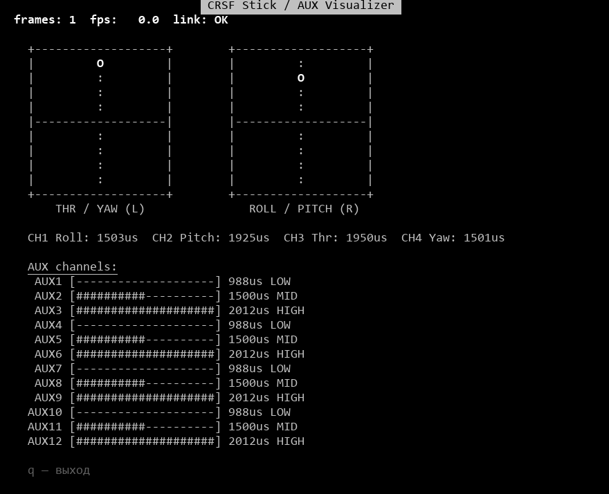
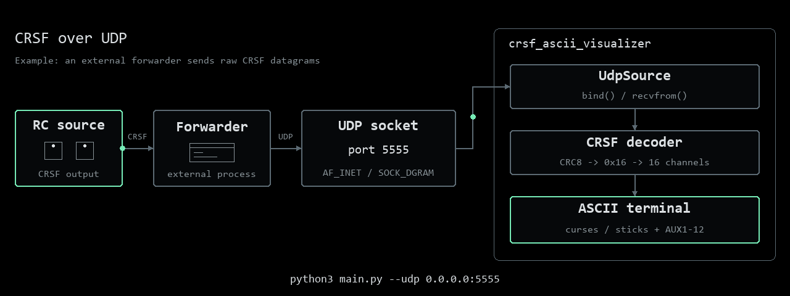
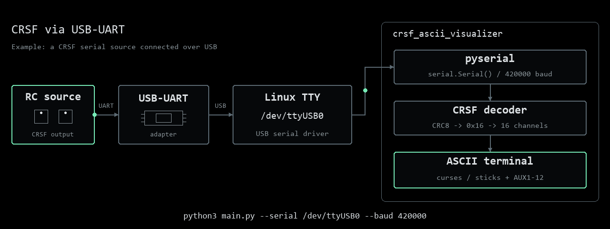
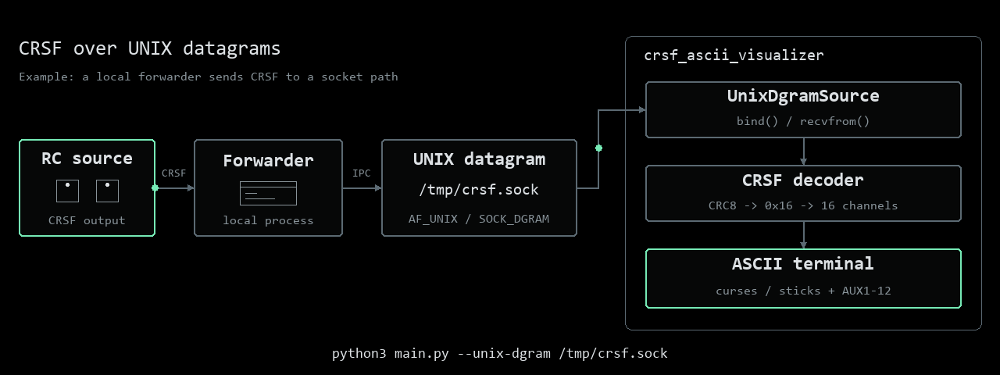
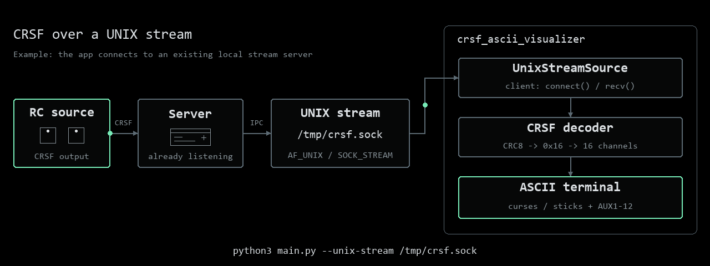

# CRSF ASCII Visualizer



*Demo: synthetic CRSF input at 250 Hz.*

## Inspect sticks and AUX over UDP



```bash
python3 main.py --udp 0.0.0.0:5555
```

## Read CRSF over UART



```bash
python3 -m pip install pyserial
python3 main.py --serial /dev/ttyUSB0 --baud 420000
```

## Listen on a UNIX datagram socket



```bash
python3 main.py --unix-dgram /tmp/crsf.sock
```

## Attach to an existing UNIX stream



```bash
python3 main.py --unix-stream /tmp/crsf.sock
```
